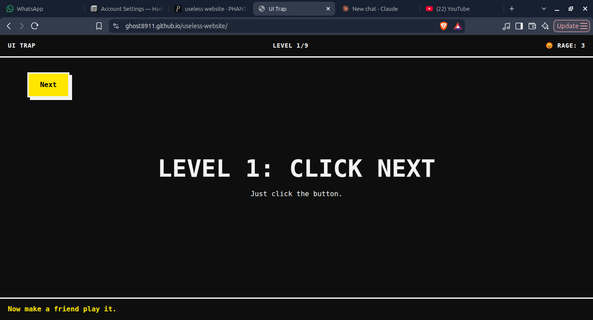

# useless-website
just to make the user ragebait 
# UI Trap

A 9-level puzzle game where the user interface actively hates you.

**[Play it here](https://ghost8911.github.io/ui-trap/)**



## What is this?

I wanted to make a game out of all the annoying UI patterns we deal with online—buttons that dodge your cursor, loading bars stuck at 99%, fake cookie banners, and checkboxes that refuse to be clicked. 

Everything is packed into a single `index.html` file with zero libraries or external audio files (the sound effects are synthesized directly with the Web Audio API).

## How to play

Beat all 9 levels with as little **Rage** as possible. 

- Clicking anywhere that isn't the actual solution adds `+1` rage.
- If normal clicking doesn't work, stop using your mouse—try keyboard shortcuts (`Tab`, `Enter`, `Space`, `End`, `Esc`), selecting hidden text, or looking closely at the page.
- If you get stuck for 22 seconds, a hint button pops up (for a `+5` rage penalty).

## Running it locally

Just clone the repo and open `index.html` in your browser:

```bash
git clone [https://github.com/Ghost8911/ui-trap.git](https://github.com/Ghost8911/ui-trap.git)
cd ui-trap
